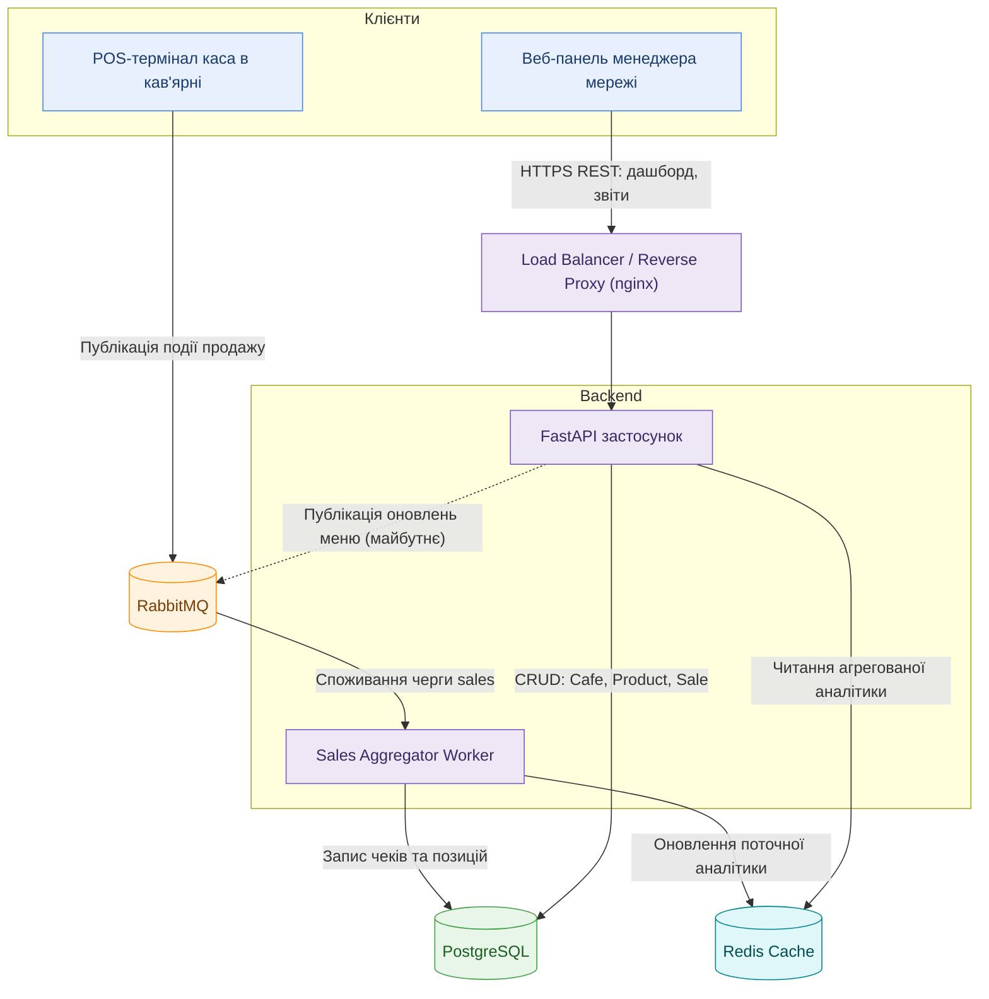
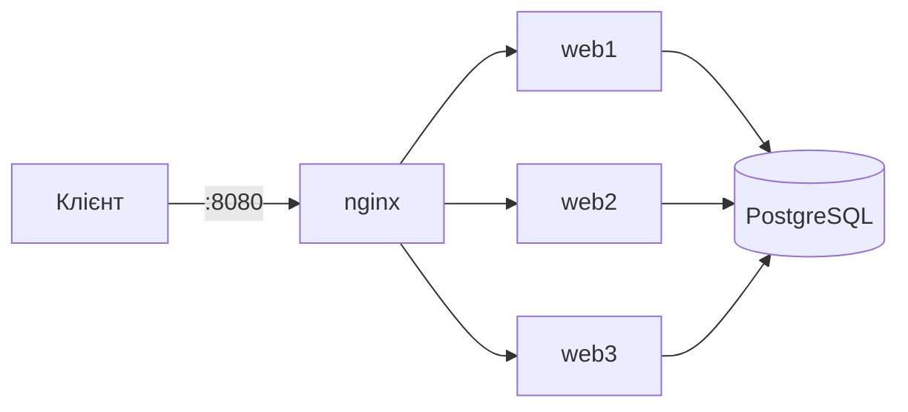
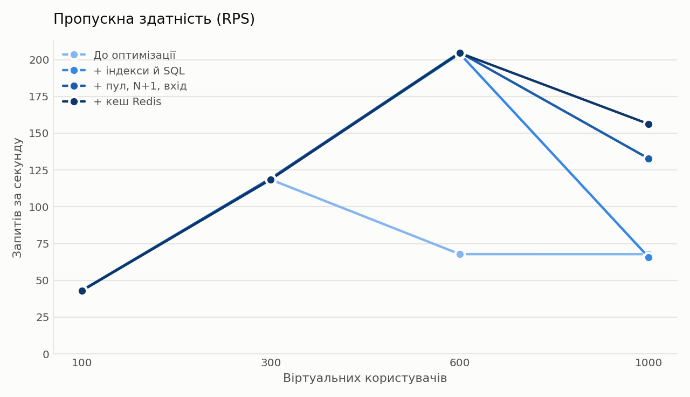
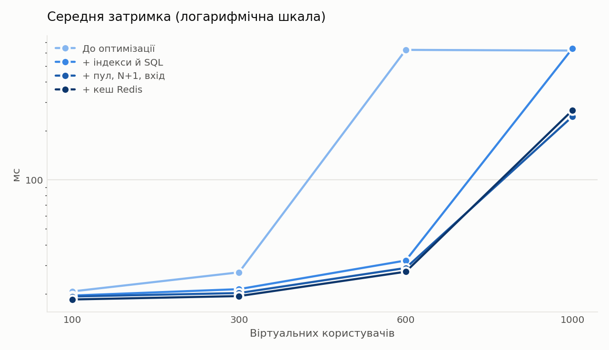
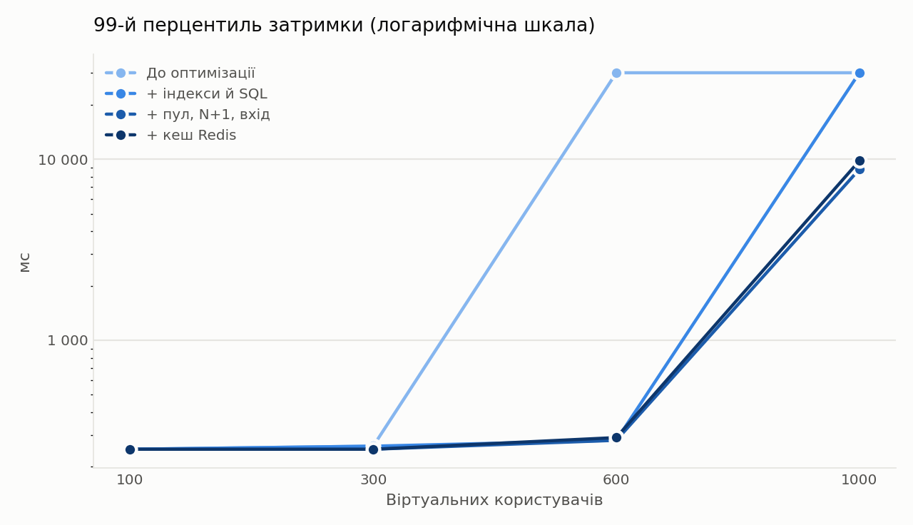
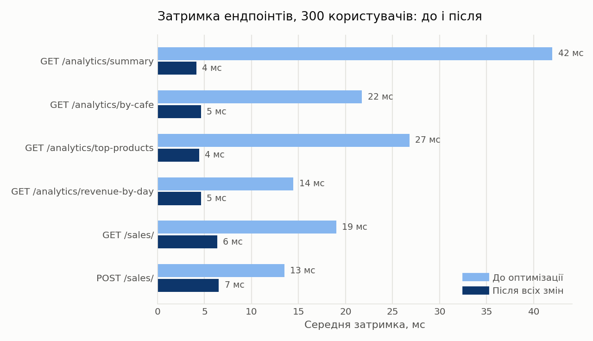

# Хмарна каса для мережі кав'ярень

## Обґрунтування вибору предметної області

Обрана предметна область — **Хмарна каса (SaaS) для мережі невеликих кав'ярень з агрегацією аналітики продажів на центральному сервері** (варіант №10), реалізована на прикладі мережі кав'ярень: кожна точка продажу має власний POS-термінал (касу), а власник мережі бачить агреговану аналітику по всіх кав'ярнях у реальному часі через центральний сервер.

Цей напрямок цікавий поєднанням реального бізнес-кейсу (SaaS-рішення для малого бізнесу) з технічно складним навантаженням — безперервним потоком транзакцій продажу від сотень кас одночасно та необхідністю швидко віддавати агреговану аналітику власнику мережі, не блокуючи основний потік записів. Це дає простір для практики роботи з чергами повідомлень, кешуванням та подієво-керованою архітектурою.

### Ключові сутності

- **Cafe** — кав'ярня мережі: назва, адреса, часовий пояс.
- **PosTerminal** — каса в конкретній кав'ярні: ідентифікатор пристрою, кав'ярня, статус (online/offline).
- **Product** — товар/позиція меню: назва, ціна, категорія (напій, десерт тощо).
- **Sale** — чек/транзакція продажу: каса, час, загальна сума, статус (оплачено/повернення).
- **SaleItem** — позиція в чеку: товар, кількість, ціна на момент продажу.

### Сценарій навантаження

1. **Безперервний потік продажів**: сотні кас у різних кав'ярнях мережі одночасно надсилають чеки на сервер, особливо в ранкові години пік. Ці дані йдуть через **RabbitMQ**, щоб згладити пікове навантаження запису в базу даних і не блокувати основний API.
2. **Одночасне читання аналітики**: поки триває потік нових продажів, власник мережі одночасно відкриває веб-панель і хоче бачити live-статистику по всіх кав'ярнях — читання агрегованих даних не повинно конкурувати з записом нових чеків, тому "гаряча" аналітика зберігається окремо в кеші.

## Архітектура системи



### Компоненти та потоки даних

1. **Клієнти:**
   - *POS-термінал* — каса в кав'ярні, що реєструє продажі та надсилає їх на сервер.
   - *Веб-панель менеджера* — інтерфейс власника мережі: перегляд аналітики продажів по всіх кав'ярнях, управління меню.

2. **Load Balancer / Reverse Proxy** — розподіляє вхідні HTTP-запити між кількома інстансами FastAPI-застосунку, забезпечуючи горизонтальне масштабування бекенду під пікове навантаження (наприклад, ранкові години пік у кав'ярнях).

3. **Backend (FastAPI застосунок)** — обробляє REST-запити: автентифікація менеджерів, віддача аналітики, CRUD-операції над кав'ярнями, товарами та чеками.

4. **RabbitMQ (Message Broker)** — приймає безперервний потік повідомлень про продажі від сотень кас, згладжуючи пікові сплески запису і розв'язуючи публікацію даних (каси) зі споживанням (Worker) у часі.

5. **Sales Aggregator Worker** — окремий процес, що споживає чергу продажів з RabbitMQ, зберігає чеки та позиції в PostgreSQL та оновлює агреговану "гарячу" аналітику (виручка за день, топ-товари тощо) у Redis-кеші.

6. **Redis Cache** — зберігає часто запитувані, швидкозмінні дані (поточна виручка, статистика за сьогодні), щоб API не звертався до PostgreSQL при кожному запиті дашборду.

7. **PostgreSQL** — основне реляційне сховище сутностей `Cafe`, `PosTerminal`, `Product`, `Sale` та `SaleItem`.

## Запуск проєкту

### Вимоги

- Python 3.9 або новіший
- PostgreSQL (на macOS: `brew install postgresql@18`)
- Git

### Встановлення

```bash
git clone https://github.com/mariia-hutsuliak-labs/cafe-pos-saas.git
cd cafe-pos-saas
python -m venv venv
source venv/bin/activate
pip install -r requirements-dev.txt
pre-commit install
```

### Середовища

Застосунок працює в двох середовищах: **sandbox** (тестове, для розробки і демонстрації) та **production** (робоче). Яке з них запущене, визначає змінна оточення `APP_ENV`. Застосунок читає налаштування з файлу `.env.<APP_ENV>`. Якщо `APP_ENV` не задано, береться `sandbox`, щоб випадково не запустити робоче середовище.

| | sandbox | production | тести (pytest) |
|---|---|---|---|
| Змінна `APP_ENV` | `sandbox` (за замовчуванням) | `production` | `test` |
| Файл налаштувань | `.env.sandbox` | `.env.production` | не потрібен, значення задає `tests/conftest.py` |
| База даних | `cafe_pos_sandbox` | `cafe_pos_production` | SQLite у пам'яті |
| `DEBUG` | `true` | `false` | `false` |
| Swagger (`/docs`) | доступний | вимкнений (404) | вимкнений |
| Помилка 500 | детальний стектрейс | коротке повідомлення | коротке повідомлення |
| Демо-дані | дозволені | заборонені | не використовуються |

Паролі, ключі та рядки підключення до баз не зберігаються в коді. Файли `.env.sandbox` і `.env.production` не потрапляють у git (див. `.gitignore`). У репозиторії є тільки шаблон `.env.example` з вигаданими значеннями. Без змінних `DATABASE_URL` і `SECRET_KEY` застосунок не стартує.

### Налаштування

1. Створи дві окремі бази:

```bash
psql -U postgres -c "CREATE DATABASE cafe_pos_sandbox;"
psql -U postgres -c "CREATE DATABASE cafe_pos_production;"
```

2. Створи файли налаштувань із шаблону:

```bash
cp .env.example .env.sandbox
cp .env.example .env.production
```

3. Відкрий `.env.sandbox` і вкажи свій пароль PostgreSQL у `DATABASE_URL`. Для `SECRET_KEY` підстав випадковий рядок.

4. Відкрий `.env.production` і зміни чотири рядки: `APP_ENV=production`, `DEBUG=false`, база `cafe_pos_production` у `DATABASE_URL` і окремий `SECRET_KEY`. Ключ можна згенерувати так:

```bash
python -c "import secrets; print(secrets.token_hex(32))"
```

Таблиці в базах створюються автоматично при першому запуску застосунку.

### Запуск у sandbox

```bash
PYTHONPATH=src uvicorn cafe_pos.main:app --reload
```

- Swagger: http://127.0.0.1:8000/docs
- Фронтенд: http://127.0.0.1:8000/app/index.html

Створити адміністратора:

```bash
PYTHONPATH=src python -m cafe_pos.create_admin <email> <пароль>
```

Заповнити базу демо-даними (повторний запуск нічого не дублює):

```bash
PYTHONPATH=src python -m cafe_pos.seed_demo_data
```

### Запуск у production

```bash
APP_ENV=production PYTHONPATH=src uvicorn cafe_pos.main:app --port 8001
```

- Фронтенд: http://127.0.0.1:8001/app/index.html
- Swagger у production вимкнений, `/docs` повертає 404.
- Автоперезапуск (`--reload`) не використовується.
- Адміністратора для production створюємо окремо, бо база порожня:

```bash
APP_ENV=production PYTHONPATH=src python -m cafe_pos.create_admin <email> <пароль>
```

- Демо-дані в production заборонені: скрипт `seed_demo_data` у цьому середовищі завершується з повідомленням про заборону.

Sandbox (порт 8000) і production (порт 8001) можна запускати одночасно, вони працюють із різними базами.

### Запуск тестів

```bash
PYTHONPATH=src pytest -v
```

Тести працюють на SQLite у пам'яті й не потребують ні PostgreSQL, ні файлів `.env`.

### Перевірка якості коду

Перед кожним комітом `pre-commit` запускає `ruff` і `ruff-format`. Перевірити всі файли вручну:

```bash
pre-commit run --all-files
```

## Запуск у Docker

Застосунок (три репліки), nginx, PostgreSQL і Redis піднімаються однією командою. Потрібен лише Docker Desktop.

### Склад

| Файл | Призначення |
|---|---|
| `Dockerfile` | Багатоетапна збірка: етап `builder` ставить залежності у venv, фінальний образ `python:3.9-slim` отримує тільки venv і `src`, працює не від root |
| `.dockerignore` | Виключає `.git`, `.env*`, `venv`, `__pycache__`, тести, логи та інше зайве |
| `docker-compose.yml` | Сервіси `web1`, `web2`, `web3`, `nginx`, `db` і `redis`, мережа `backend`, том `pgdata`, `healthcheck` та `depends_on` |
| `nginx/` | Конфіги балансувальника: `nginx.conf` (Round Robin), `nginx.weighted.conf`, `nginx.least_conn.conf` |
| `scripts/` | Демонстрація розподілу запитів і відмовостійкості |
| `docker-compose.dev.yml` | Режим розробки: bind mount `./src` і `--reload` |
| `.env.docker.example` | Шаблон змінних оточення для Docker |
| `requirements.txt` / `requirements-dev.txt` | Залежності для роботи / додатково інструменти розробки |

### Запуск

```bash
cp .env.docker.example .env
```

Відкрий `.env`, зміни `POSTGRES_PASSWORD` і `SECRET_KEY`. Файл `.env` не потрапляє в git.

```bash
docker compose up --build
```

Перевірка: http://127.0.0.1:8080/health/db (через nginx) повертає `{"database":"connected"}`, фронтенд на http://127.0.0.1:8080/app/index.html. Репліка `web1` додатково відкрита напряму на порту 8000. Таблиці створюються при старті застосунку.

Адміністратор і демо-дані (у другій вкладці):

```bash
docker compose exec web1 python -m cafe_pos.create_admin <email> <пароль>
docker compose exec web1 python -m cafe_pos.seed_demo_data
```

База даних:

```bash
docker compose exec db psql -U cafe_pos -d cafe_pos_docker
```

### Дані переживають перезапуск

`docker compose down` видаляє контейнери, але не том `pgdata`, тому дані лишаються. Повне очищення разом із даними: `docker compose down -v`.

### Режим розробки з hot-reload

```bash
docker compose -f docker-compose.yml -f docker-compose.dev.yml up --build
```

Папка `src` підключена до контейнера, uvicorn працює з `--reload`: після збереження файлу сервер перезапускається без перезбірки образу. У цьому режимі `DEBUG=true`, тож доступний Swagger.

### Розмір образу

```bash
docker images
```

## Навантажувальне тестування

Інструмент: [Locust](https://locust.io). Сценарій лежить у `loadtests/locustfile.py` і імітує три типи користувачів одночасно:

| Тип користувача | Частка | Що робить |
|---|---|---|
| Каса | 70% | входить, дивиться товари й кав'ярні, створює чеки з 1–3 товарами |
| Власник мережі | 20% | входить, відкриває аналітику (`summary`, `revenue-by-day`, `top-products`, `by-cafe`) і останні чеки |
| Лише вхід | 10% | постійно викликає `POST /auth/login` |

Ресурси сервера (CPU, RAM процесу uvicorn і PostgreSQL, навантаження всієї машини) пише окремий скрипт `loadtests/monitor_resources.py` на базі psutil. Результати запусків потрапляють у теку `results/`, її немає в git.

Логін і пароль тестового адміністратора передаються змінними оточення `LOAD_ADMIN_EMAIL` і `LOAD_ADMIN_PASSWORD`, у коді їх немає. Створювати чеки може тільки адмін, тому всі три типи користувачів входять під ним.

### Запуск навантаження

Тестуємо sandbox із демо-даними. Створи адміністратора для тестів:

```bash
PYTHONPATH=src python -m cafe_pos.create_admin load@example.com loadpass123
```

Запусти сервер без `--reload`, інакше процесів буде два і виміри ресурсів спотворяться:

```bash
PYTHONPATH=src uvicorn cafe_pos.main:app --port 8000
```

У другій вкладці запусти монітор ресурсів (150 секунд з запасом на 2 хвилини тесту):

```bash
python loadtests/monitor_resources.py --out results/resources_u100.csv --duration 150
```

У третій вкладці запусти Locust. Приклад на 100 користувачів, розгін 10 користувачів за секунду, 2 хвилини:

```bash
LOAD_ADMIN_EMAIL=load@example.com LOAD_ADMIN_PASSWORD=loadpass123 locust -f loadtests/locustfile.py --host http://127.0.0.1:8000 --headless -u 100 -r 10 -t 2m --csv results/u100 --html results/u100.html
```

### Результати

П'ять запусків по 2 хвилини, Locust, сервер і PostgreSQL на одному ноутбуці:

| Користувачів | RPS | Середня, мс | Помилок |
|---|---|---|---|
| 10 | 4,4 | 23,1 | 0 |
| 50 | 21,5 | 20,6 | 1 |
| 100 | 43,4 | 20,2 | 0 |
| 200 | 87,1 | 26,8 | 0 |
| 300 | 10,8 | 7245 | 107 (10,1%) |

До 200 користувачів система масштабується лінійно: приблизно 0,43 запиту за секунду на одного користувача. Між 200 і 300 вичерпується пул підключень SQLAlchemy (5 + 10 додаткових), потоки й підключення чекають одне одного, сервер майже на 30 секунд перестає відповідати, а запити падають з HTTP 500 (`QueuePool limit of size 5 overflow 10 reached`). CPU сервера і PostgreSQL у цей час простоюють.

Другорядні вузькі місця:

- вхід через bcrypt триває близько 200 мс, у кілька разів довше за інші ендпоінти;
- `GET /analytics/summary` рахує суми в Python, а не в SQL, тому його затримка росте разом з навантаженням.

## Балансування навантаження (Nginx)

Один екземпляр застосунку впирається у свої межі (див. результати навантаження вище), тому застосунок масштабується горизонтально: три однакові репліки `web1`, `web2`, `web3` стоять за nginx, який є єдиною точкою входу.



Репліки збираються з одного образу й підключені до однієї бази. Токени JWT перевіряє кожна репліка самостійно, тому спільне сховище сесій не потрібне.

### Як видно, яка репліка відповіла

Застосунок повертає ім'я свого сервера (у Docker це ID контейнера) двома способами: поле `instance` у відповіді `GET /` і заголовок `X-Served-By` у кожній відповіді.

```bash
curl -i http://127.0.0.1:8080/
```

### Налаштування nginx

У `nginx/nginx.conf` блок `upstream cafe_backend` перелічує три репліки, а блок `server` слухає порт 80 (на комп'ютері це 8080) і передає запити через `proxy_pass`. Без додаткових директив nginx використовує Round Robin: запити йдуть по колу `web1`, `web2`, `web3`.

Відмовостійкість налаштована пасивною перевіркою здоров'я (в open-source nginx активних перевірок немає):

- `max_fails=2 fail_timeout=10s`: після двох невдалих спроб репліка виключається з розподілу на 10 секунд, потім nginx пробує її знову;
- `proxy_next_upstream error timeout http_502 http_503`: якщо репліка не відповіла, цей самий запит одразу йде на наступну, і клієнт не бачить помилки.

Обмеження: якщо перезапустити сам nginx, поки якась репліка вимкнена, він не стартує, бо не може визначити її адресу. Спершу піднімають усі репліки.

### Round Robin

```bash
./scripts/rr_demo.sh 20
```

Скрипт робить 20 запитів і друкує репліку для кожного, а в кінці підсумок. Очікувано: запити чергуються `web1, web2, web3, web1, ...`, підсумок приблизно 7 / 7 / 6.

### Відмовостійкість

```bash
./scripts/failover_demo.sh
```

Скрипт показує розподіл на трьох репліках, зупиняє `web2` (`docker compose stop web2`), знову робить запити (усі `HTTP 200`, відповідають тільки `web1` і `web3`), запускає `web2` назад і показує, що вона повернулась у розподіл. У логах nginx видно спроби підключення до зупиненої репліки: `docker compose logs nginx`.

### Інші алгоритми

Конфіг вибирає змінна `NGINX_CONF` у `.env`. Після зміни перестворити лише nginx:

```bash
NGINX_CONF=./nginx/nginx.weighted.conf docker compose up -d nginx
./scripts/rr_demo.sh 20
```

| Файл | Алгоритм | Очікуваний розподіл 20 запитів |
|---|---|---|
| `nginx.conf` | Round Robin | 7 / 7 / 6 |
| `nginx.weighted.conf` | Weighted Round Robin, `weight=3` для `web1` | 12 / 4 / 4 |
| `nginx.least_conn.conf` | Least Connections | близько 7 / 7 / 6 (запити короткі, тому майже як Round Robin) |

Weighted підходить, коли сервери різної потужності. Least Connections виграє, коли запити різної тривалості (наприклад, важка аналітика поряд із легкими запитами).

### Порівняння з одним екземпляром (Locust)

Сценарій той самий, що в `loadtests/locustfile.py`. Один екземпляр це `web1` напряму (порт 8000), три репліки це nginx (порт 8080) з конфігом `nginx.conf`. Усі прогони по 2 хвилини, розгін 10 користувачів за секунду.

Чеки, які створює навантаження, накопичуються в базі, а `GET /analytics/summary` читає всі сьогоднішні чеки, тому кожен наступний прогін іде в гірших умовах за попередній. Щоб порівняння було чесним, скрипт `loadtests/compare.sh` перед кожним прогоном очищає чеки, заново створює демо-дані й перезапускає репліки та nginx.

Перед запуском створи адміністратора для тестів:

```bash
docker compose exec web1 python -m cafe_pos.create_admin load@example.com loadpass123
```

```bash
export LOAD_ADMIN_EMAIL=load@example.com LOAD_ADMIN_PASSWORD=loadpass123
```

```bash
./loadtests/compare.sh
```

Скрипт проганяє 100, 200 і 300 користувачів для обох конфігурацій (близько 15 хвилин). Результати лежать у `results/fair_*_stats.csv` і `results/fair_*.html`. У Docker Desktop мають бути виділені не менше 4 CPU.

Результати (рядок `Aggregated`):

| Користувачів | Конфігурація | Запитів за 2 хв | RPS | Середня, мс | p95, мс | Помилок |
|---|---|---|---|---|---|---|
| 100 | 1 екземпляр | 5152 | 43,2 | 20,1 | 190 | 3 (0,06%) |
| 100 | 3 репліки + nginx | 5180 | 43,4 | 19,0 | 190 | 0 |
| 200 | 1 екземпляр | 9921 | 83,2 | 19,9 | 200 | 0 |
| 200 | 3 репліки + nginx | 9917 | 83,1 | 22,1 | 230 | 0 |
| 300 | 1 екземпляр | 10673 | 115,8 | 40,4 | 280 | 0 |
| 300 | 3 репліки + nginx | 14198 | 119,0 | 23,4 | 230 | 0 |

Висновки:

- На 100 і 200 користувачах один екземпляр справляється сам. Кількість запитів однакова, а затримка майже однакова: nginx додає кілька мілісекунд. Тому репліки там нічого не дають.
- На 300 користувачах один екземпляр починає відставати. Три репліки обробили 14 198 запитів проти 10 673 (на 33% більше), середня затримка впала з 40,4 до 23,4 мс, а 90-й перцентиль з 92 до 25 мс (колонка `90%` у CSV). Помилок немає в обох варіантах.
- RPS у Locust це кількість запитів, поділена на час між першим і останнім запитом. Для прогону `single_u300` цей час вийшов приблизно 92 с замість 120 с, тому його RPS (115,8) завищений. Для порівняння надійніша кількість запитів за ті самі 2 хвилини.
- Усі репліки працюють з однією базою PostgreSQL і ділять процесор одного ноутбука, тому виграш менший за втричі. Вузьким місцем лишається спільна база.

## Оптимізація продуктивності

У лабі 4 ми знайшли вузькі місця, у лабі 6 масштабували систему вшир. Тут виправляємо те, що знайшли, і вимірюємо результат: ті самі тести «до» і «після» кожної зміни.

### Як вимірювали

Інструмент і сценарій ті самі, що в лабі 4: Locust, `loadtests/locustfile.py` (каса 70%, власник мережі 20%, лише входи 10%), розгін 10 користувачів за секунду, кожен прогін 2 хвилини. Відрізняється середовище й навантаження, і це зроблено навмисно:

| Що | Лаба 4 | Лаба 7 | Навіщо |
|---|---|---|---|
| Де працює | uvicorn на ноутбуці | один екземпляр `web1` у Docker (порт 8000), база і Redis теж у Docker | як у лабі 6, і CPU та RAM видно через `docker stats` |
| Дані в базі | кілька сотень чеків | 100 000 чеків за 90 днів (`loadtests/bulk_sales.sql`) | у реальній мережі чеків багато, на малій базі індекси й агрегації не видно |
| Користувачів | 10-300 | 100, 300, 600, 1000 | на 300 з малою базою система не ламалась, треба знайти межу |

Перед кожним прогоном скрипт `loadtests/bench.sh` збирає образ, очищає чеки, створює демо-дані й 100 000 чеків, робить `VACUUM ANALYZE` і перевіряє вхід. Так усі прогони стартують з однакового стану. Під час прогону пише CPU і RAM контейнерів `web1` та `db` (`docker stats`).

```bash
export LOAD_ADMIN_EMAIL=load@example.com LOAD_ADMIN_PASSWORD=loadpass123
```

```bash
BULK_SALES=100000 ./loadtests/bench.sh before_100k 100 300 600 1000
```

Мітку `before_100k` змінюють на `after_idx_100k`, `after_pool_100k`, `after_redis_100k` залежно від етапу. Файли потрапляють у `results/lab7/` (у git їх немає). Таблиці й графіки з них будує `python loadtests/make_report.py` у `docs/lab7/`.

Важливо знати про цифри:

- RPS тут це кількість запитів за 2 хвилини, поділена на 120 с. Так надійніше, ніж значення Locust, яке рахується від першого до останнього запиту і завищується, якщо сервер зависав.
- На кожну конфігурацію один прогін, тож різниця в кілька відсотків лежить у межах розкиду.
- Користувачі Locust роблять паузи 1-5 с, тому до насичення RPS росте лінійно (приблизно 0,4 запиту за секунду на користувача) і від швидкості сервера не залежить. Покращення видно в затримках і в тому, що система не ламається на великому навантаженні.
- Перший замір на малій базі (410 чеків) показав 43, 83 і 119 запитів за секунду на 100, 200 і 300 користувачах без збоїв. Тобто там вузьке місце не проявлялось, тому для лаби взято базу на 100 000 чеків.

### Вузькі місця

| # | Знахідка | Чим підтверджено | Що зробили |
|---|---|---|---|
| 1 | Пул підключень SQLAlchemy 5 + 10, очікування 30 с | на 600 і 1000 користувачів p99 рівно 30 000 мс і HTTP 500; у логах `QueuePool limit of size 5 overflow 10 reached` | налаштовуваний пул 20 + 20, таймаут 10 с |
| 2 | У таблицях `sales` і `sale_items` немає індексів | `EXPLAIN ANALYZE`: повне сканування, `/sales/` 5,8 мс, позиції чеків 18,9 мс | індекси |
| 3 | `/analytics/summary` вантажив усі сьогоднішні чеки в Python і брав `date(created_at)`, який не може використати індекс | на 300 користувачах 42 мс, найповільніший ендпоінт аналітики, і росте разом з кількістю чеків | підрахунок в SQL за діапазоном часу |
| 4 | N+1 у `POST /sales/`: окремий запит на кожен товар чека, потім `UPDATE` і `refresh` | код | один запит на всі товари, один запис |
| 5 | Вхід тримає підключення до бази під час bcrypt (~210 мс) | код; `login` найповільніший ендпоінт | підключення повертається в пул до bcrypt |
| 6 | `by-cafe` і `top-products` читають усю таблицю щоразу | `EXPLAIN`: індекс не допомагає (20 мс і 22 мс) | кеш |

### Що змінено (стратегії)

**Стратегія 1. База даних: індекси й агрегація в SQL.** Додано індекси `sales.created_at`, `sales.cafe_id`, `sale_items.sale_id`, `sale_items.product_id`. `create_all` додає індекси лише до нових таблиць, тому при старті викликається `create_missing_indexes()` (`CREATE INDEX IF NOT EXISTS`). `/analytics/summary` тепер рахує `count` і `sum` у базі за діапазоном `created_at`. Формат відповіді не змінився.

**Стратегія 2. Код застосунку: пул підключень, N+1 і вхід.**
- Розмір пулу береться з налаштувань: `DB_POOL_SIZE=20`, `DB_MAX_OVERFLOW=20`, `DB_POOL_TIMEOUT=10`. Разом 40 підключень, як потоків за замовчуванням. Для бази у `docker-compose.yml` додано `max_connections=200`, бо три репліки по 40 це 120, а за замовчуванням дозволено 100.
- `create_sale` вибирає всі товари чека одним запитом, створює чек разом з позиціями й робить один `commit`.
- `login` читає користувача, повертає підключення в пул (`db.close()`) і лише потім перевіряє пароль через bcrypt.

**Стратегія 3 (додаткове завдання). Кеш Redis з TTL.** Сервіс `redis` у `docker-compose.yml` (без запису на диск, до 64 МБ, витіснення найстаріших ключів). Модуль `services/cache.py`.

| Що кешується | Ключ | TTL | Коли скидається |
|---|---|---|---|
| `GET /analytics/summary` | `analytics:summary` | 10 с | лише за TTL |
| `GET /analytics/revenue-by-day`, `top-products`, `by-cafe` | `analytics:...` | 30 с | лише за TTL |
| `GET /products/` | `products:list` | 30 с | одразу при створенні, зміні, видаленні товару |
| `GET /cafes/` | `cafes:list` | 30 с | одразу при створенні, зміні, видаленні кав'ярні |

Перевірка прав доступу виконується перед кешем, тож кеш її не обходить. Якщо `REDIS_URL` не заданий або Redis недоступний, застосунок працює як раніше, а запити не чекають: після збою Redis не опитується 5 секунд. Ціна кешу: аналітика може відставати від бази до 10-30 секунд, для дашборда це прийнятно. Вимкнути кеш: `REDIS_URL= docker compose up -d`.

Бізнес-логіку не порушено: усі 23 тести проходять, нові перевіряють підсумок за сьогодні, створення чека (невідомий товар, той самий товар двічі), кеш та його скидання, роботу без Redis і вхід.

### Результати

Кожен наступний етап включає всі попередні зміни. 100 000 чеків у базі, 1 екземпляр, прогін 2 хвилини.

#### Загальна таблиця (100 тис. чеків, 1 екземпляр, прогін 2 хв)

| Користувачів | Етап | Запитів | RPS | Середня, мс | p95, мс | p99, мс | Помилок | CPU web1 серед./макс., % | CPU db серед., % | RAM web1 макс., МБ |
|---|---|---|---|---|---|---|---|---|---|---|
| 100 | До оптимізації | 5 158 | 43,0 | 21 | 190 | 250 | 0 (0,00%) | 67 / 273 | 9 | 84 |
| 100 | + індекси й SQL | 5 151 | 42,9 | 20 | 200 | 250 | 0 (0,00%) | 73 / 304 | 7 | 73 |
| 100 | + пул, N+1, вхід | 5 186 | 43,2 | 19 | 200 | 250 | 0 (0,00%) | 70 / 286 | 7 | 77 |
| 100 | + кеш Redis | 5 161 | 43,0 | 18 | 190 | 250 | 0 (0,00%) | 65 / 266 | 2 | 69 |
| 300 | До оптимізації | 14 217 | 118,5 | 27 | 200 | 260 | 1 (0,01%) | 208 / 470 | 24 | 112 |
| 300 | + індекси й SQL | 14 279 | 119,0 | 21 | 200 | 260 | 0 (0,00%) | 188 / 404 | 18 | 84 |
| 300 | + пул, N+1, вхід | 14 324 | 119,4 | 20 | 200 | 250 | 1 (0,01%) | 183 / 419 | 17 | 82 |
| 300 | + кеш Redis | 14 236 | 118,6 | 19 | 200 | 250 | 0 (0,00%) | 178 / 429 | 3 | 83 |
| 600 | До оптимізації | 8 139 | 67,8 | 627 | 280 | 30 000 | 64 (0,79%) | 180 / 566 | 14 | 145 |
| 600 | + індекси й SQL | 24 483 | 204,0 | 32 | 200 | 280 | 2 (0,01%) | 365 / 698 | 36 | 99 |
| 600 | + пул, N+1, вхід | 24 586 | 204,9 | 29 | 200 | 280 | 0 (0,00%) | 361 / 611 | 30 | 95 |
| 600 | + кеш Redis | 24 541 | 204,5 | 27 | 200 | 290 | 4 (0,02%) | 354 / 564 | 6 | 94 |
| 1000 | До оптимізації | 8 137 | 67,8 | 621 | 290 | 30 000 | 70 (0,86%) | 191 / 580 | 14 | 170 |
| 1000 | + індекси й SQL | 7 879 | 65,7 | 641 | 280 | 30 000 | 71 (0,90%) | 182 / 638 | 11 | 151 |
| 1000 | + пул, N+1, вхід | 15 927 | 132,7 | 245 | 280 | 8 800 | 90 (0,57%) | 304 / 706 | 20 | 154 |
| 1000 | + кеш Redis | 18 748 | 156,2 | 268 | 290 | 9 800 | 103 (0,55%) | 342 / 831 | 7 | 159 |

#### Ендпоінти при 300 користувачах: середня затримка / p95, мс

| Ендпоінт | До оптимізації | + індекси й SQL | + пул, N+1, вхід | + кеш Redis |
|---|---|---|---|---|
| GET /analytics/summary | 42 / 85 | 7 / 24 | 7 / 21 | 4 / 11 |
| GET /analytics/by-cafe | 22 / 54 | 17 / 32 | 16 / 27 | 5 / 14 |
| GET /analytics/top-products | 27 / 77 | 19 / 30 | 19 / 27 | 4 / 14 |
| GET /analytics/revenue-by-day | 14 / 42 | 9 / 20 | 8 / 16 | 5 / 13 |
| GET /sales/ | 19 / 44 | 7 / 23 | 7 / 18 | 6 / 16 |
| POST /sales/ | 13 / 52 | 8 / 21 | 7 / 15 | 7 / 15 |
Пропускна здатність:



Середня затримка:



99-й перцентиль затримки (колонка p99; вона показує, скільки чекають найповільніші 1% запитів):



Де саме виграли (300 користувачів, середня затримка ендпоінтів):



### EXPLAIN ANALYZE

Скрипт `loadtests/explain.sh` знімає плани запитів із `loadtests/explain_queries.sql` двічі: без індексів і з індексами (на тих самих 107 158 чеках). Повні плани він пише в `results/lab7/explain_before.txt` і `explain_after.txt`.

| Запит | Без індексів | З індексами |
|---|---|---|
| Q0. Старий /analytics/summary: date(created_at) = сьогодні, всі рядки у Python | 7,47 | 7,00 |
| Q1. Новий /analytics/summary: count і sum за діапазоном created_at | 7,24 | 1,31 |
| Q2. /analytics/revenue-by-day (14 днів) | 12,96 | 6,44 |
| Q3. /sales/?limit=20: останні чеки | 5,77 | 0,01 |
| Q4. Позиції останніх чеків (joinedload у /sales/) | 18,89 | 0,05 |
| Q5. /analytics/by-cafe: сума по всіх чеках | 20,01 | 18,51 |
| Q6. /analytics/top-products: сума по всіх позиціях | 22,43 | 22,93 |

- `/sales/` (Q3) і позиції останніх чеків (Q4): з індексом база бере останні 20 чеків і їхні позиції через індекс замість повного сканування й сортування, тож 5,77 мс стали 0,01 мс, а 18,89 мс стали 0,05 мс.
- Новий `summary` (Q1): діапазон за часом тепер іде по індексу, 7,24 мс стали 1,31 мс.
- Старий `summary` (Q0) від індексу не виграв (7,47 та 7,00 мс), бо `date(created_at)` обгортає стовпець функцією і індекс не використовується. Тому запит і переписано на діапазон.
- `revenue-by-day` (Q2) прискорився вдвічі.
- `by-cafe` (Q5) і `top-products` (Q6) індекс не змінив, бо вони агрегують усю таблицю. Саме їх закрив кеш.

### Висновки

1. **Найбільший приріст дали індекси й SQL-агрегація.** На 600 користувачах RPS зріс із 67,8 до 204,0 (у 3 рази), середня затримка впала з 627 до 32 мс, p99 з 30 000 до 280 мс, помилки з 64 до 2. Імовірна причина: повільні запити тримали підключення до бази так довго, що вичерпувався пул. Запити прискорились, підключення стали звільнятися швидше.
2. **Пул, N+1 і вхід потрібні на межі.** На 100-600 користувачах вони майже нічого не змінили, але на 1000 подвоїли RPS (65,7 → 132,7) і втричі зменшили середню затримку (641 → 245 мс).
3. **Redis прискорив аналітику в 3-5 разів** (при 300 користувачах `summary` 42 → 4 мс, `by-cafe` 22 → 5 мс, `top-products` 27 → 4 мс) і зменшив навантаження на базу з 24% до 3% CPU. Загальний RPS майже не змінився, бо тепер обмежує процесор застосунку.
4. **Разом, порівняно з початком:** на 600 користувачах у 3 рази більше запитів без збоїв, на 1000 у 2,3 раза більше (67,8 → 156,2). На 100 і 300 користувачах система й раніше справлялась, там змінились лише затримки ендпоінтів.
5. **Що лишилось.** На 1000 користувачів ще 0,55% помилок (було 0,86%) і p99 близько 9,8 с. CPU контейнера `web1` піднімається до 831%, а база майже не завантажена (CPU db 7%). Імовірна причина: перевірка пароля bcrypt, приблизно 210 мс процесора на вхід, а в сценарії близько 22 входів за секунду. Це оцінка за розрахунком, прямого виміру частки bcrypt немає. Зменшувати складність bcrypt не варто, бо це послабить захист. Наступний крок: горизонтальне масштабування, тобто три репліки з nginx із лаби 6, тепер з уже швидкою базою й кешем.

## Фінальне тестування стабільності

У лабах 4-7 тести тривали 2 хвилини. Проблеми, які з'являються через години (витік пам'яті, незакриті підключення, повільне зростання затримки), за 2 хвилини не видно. Тут ми запускаємо стабільне навантаження на цілу годину і дивимось, чи система залишається такою самою. Тестується весь стек із лаби 6 і 7: nginx → три репліки застосунку → PostgreSQL + Redis, усе в Docker.

### Профіль стабільності і критерії

| Що | Значення | Звідки |
|---|---|---|
| Навантаження | 350 користувачів (сценарій `loadtests/locustfile.py`: каса 70%, власник мережі 20%, лише входи 10%) | Очікується близько 150 RPS, це 70-80% від максимуму 204 RPS з лаби 7 (600 користувачів, без збоїв) |
| Тривалість | 1 година (методичка радить від 1 до 4 годин) | Розігрів 5 хв не враховується в висновках про тренд |
| Дані на старті | 100 000 чеків за 90 днів + демо-дані | Як у лабі 7 |
| CPU | не більше 80% | Сума CPU всіх контейнерів, поділена на всі ядра Docker. Береться середнє за тест, 95-й перцентиль і максимум показуються окремо |
| RAM | не більше 80% | Сума RAM контейнерів, поділена на пам'ять Docker |
| Error Rate | не більше 0,1% | Відсоток невдалих запитів за Locust |

Кількість користувачів 350 підібрано за пробним прогоном на 3 хвилини: 100 користувачів дали стабільні 42,6 RPS, тож 350 дають близько 150 RPS, це 73% від максимуму 204 RPS з лаби 7 (600 користувачів, без збоїв). Фактичний RPS записується в звіт, тому якщо він вийде за межі 70-80%, кількість користувачів міняють у команді запуску. Максимум для всього стеку з трьома репліками окремо визначає стрес-тест (нижче).
Критерії стабільності, які перевіряє звіт, крім трьох обов'язкових:

- **Витоки пам'яті.** Для кожного контейнера порівнюється пам'ять у перші і в останні 10 хвилин після розігріву. Підозра на витік, коли пам'ять виросла більш ніж на 10 МБ і 10%, ріст схожий на пряму (R² не менше 0,5) і не виходить на плато. Кеш і буфери бази природно ростуть на початку, а потім стабілізуються, це «плато», а не витік. Пороги це наша евристика, вони записані на початку `loadtests/soak_report.py`.
- **Підключення до бази.** Кількість підключень до PostgreSQL на початку і в кінці має бути приблизно однаковою.
- **Деградація затримки.** Середня, p95 і p99 у перші і останні 10 хвилин. Деградація це зростання більш ніж у 1,2 раза і більш ніж на 20 мс.
- **Стійкість контейнерів.** Жодного перезапуску і жодного OOM-kill.

### Що додано

| Файл | Навіщо |
|---|---|
| `loadtests/soak.sh`, `lab8_prepare.sh` | Готують стек і дані (очищення чеків, перезапуск реплік, 100 000 чеків), запускають збір метрик і Locust на задану тривалість |
| `loadtests/soak_monitor.py` | Кожні 10 с пише CPU і RAM контейнерів, підключення до PostgreSQL, розмір бази, кількість чеків, пам'ять Redis |
| `loadtests/soak_report.py` | З результатів будує протокол: таблиці, графіки, перевірку критеріїв, висновок |
| `loadtests/locustfile.py` | Додано повторний вхід, коли JWT-токен старший за 50 хв (токен живе 60 хв, без цього після години всі запити були б 401) |
| `src/cafe_pos/services/metrics.py`, `/metrics` | Метрики Prometheus: запити, затримки, пул підключень, кеш; RSS і відкриті файли процесу додає сама бібліотека. Nginx шлях `/metrics` назовні закриває (404) |
| `docker-compose.yml` | Ротація логів контейнерів (3 файли по 10 МБ), щоб за години тесту логи не заповнили диск |
| `loadtests/stress.sh`, `locustfile_stress.py`, `stress_report.py` | Додаткове завдання 1: стрес-тест і раптовий пік |
| `docker-compose.monitoring.yml`, `monitoring/` | Додаткове завдання 2: Prometheus + Grafana + cAdvisor з готовим дашбордом |

### Запуск soak-тесту

Потрібен адмін для тестів (як у лабі 6). Якщо його ще немає, спершу піднімаємо стек:

```bash
docker compose up -d --build --wait
```

```bash
docker compose exec web1 python -m cafe_pos.create_admin load@example.com loadpass123
```

```bash
export LOAD_ADMIN_EMAIL=load@example.com LOAD_ADMIN_PASSWORD=loadpass123
```

Спершу пробний прогін на 3 хвилини, щоб перевірити, що все працює. Звіт скаже, що даних замало для висновку про витоки, це нормально:

```bash
./loadtests/soak.sh 3m 100
```

```bash
python loadtests/soak_report.py
```

Основний прогін на годину. Ноутбук має бути підключений до живлення, термінал не закривати. На Mac скрипт сам запускає `caffeinate`, щоб комп'ютер не заснув. У Docker Desktop мають бути виділені не менше 4 CPU і 6 ГБ пам'яті.

```bash
./loadtests/soak.sh 1h 350
```

Скрипт сам піднімає стек, очищає чеки, перезапускає репліки, додає 100 000 чеків, перевіряє вхід, запускає збір метрик і Locust. Файли лежать у `results/lab8/` (у git їх немає). Коли тест закінчився, будуємо протокол і вставляємо його в цей README між маркерами розділу «Результати»:

```bash
python loadtests/soak_report.py --warmup-min 5 --update-readme README.md
```

Картинки лежать у `docs/lab8/`. Звіт також окремим файлом: `docs/lab8/report.md`, а числа в `docs/lab8/summary.json`.

Що важливо знати про цифри:

- Locust працює на хості поза Docker. На ноутбуці він забирає частину процесора, тож CPU хоста вищий, ніж показує звіт. Звіт рахує тільки контейнери.
- Користувачі Locust роблять паузи 1-6 секунд, тому RPS визначається кількістю користувачів, а не швидкістю сервера. Якість системи видно в затримках і помилках.
- Чеки, які створює тест, накопичуються в базі. `GET /analytics/by-cafe` і `top-products` читають всю таблицю (їх результат кешується на 30 с), тож з ростом таблиці вони повільнішають. Частина росту затримки і RAM у `db` це ріст даних, а не витік. Звіт показує кількість чеків на початку і в кінці, щоб це було видно.
- Один прогін на конфігурацію, тож різниця в кілька відсотків лежить у межах розкиду.

### Стрес-тест і пошук точки зламу (додаткове завдання 1)

Покрокове навантаження: кожні 60 секунд додається по 100 користувачів до 1500 або до зламу (понад 50% помилок в кінці кроку). Після цього 3 хвилини працює базове навантаження, щоб побачити, чи система сама оговталась. Приблизно 18 хвилин.

```bash
./loadtests/stress.sh step
```

```bash
python loadtests/stress_report.py --mode step --label stress_step --update-readme README.md
```

Раптовий пік: 150 користувачів 2 хвилини, стрибок до 900 на 1 хвилину, знову 150 на 4 хвилини. Приблизно 7 хвилин.

```bash
./loadtests/stress.sh spike
```

```bash
python loadtests/stress_report.py --mode spike --label stress_spike --update-readme README.md
```

Як звіт визначає результат:

- **Насичення.** Крок, на якому RPS перестає рости (приріст менший за 3%).
- **Точка зламу (Break Point).** Перший крок, де помилок понад 1% або p95 понад 2 с.
- **Час відновлення.** Через скільки секунд після спаду навантаження p95 не перевищує 1,5 від базового (і не більший за базовий плюс 100 мс), а помилок не більше 0,1% протягом 30 с підряд. Без ручного втручання, лише з `restart: unless-stopped` і healthcheck з `docker-compose.yml`.

Параметри (кроки, максимум, висота піку) змінюються змінними оточення, список у `loadtests/locustfile_stress.py`. Наприклад, `MAX_USERS=2500 STEP_USERS=250 ./loadtests/stress.sh step`. Якщо Locust сам впирається в процесор (він показує попередження про CPU понад 90%), навантаження на системі буде нижче заявленого. Тоді запускають Locust з кількома процесами, додавши `--processes 4` у команду запуску в скрипті.

### Моніторинг: Prometheus + Grafana (додаткове завдання 2)

Застосунок віддає метрики на `/metrics` кожної репліки. Prometheus збирає їх кожні 5 секунд разом з метриками контейнерів від cAdvisor. Grafana показує готовий дашборд «Cafe POS: стабільність»: RPS, p50/p95/p99, помилки 5xx, CPU і RAM з порогом 80%, RSS процесу і відкриті файли кожної репліки, зайняті підключення пулу, частку влучань кешу.

Моніторинг підключається другим compose-файлом:

```bash
docker compose -f docker-compose.yml -f docker-compose.monitoring.yml up -d
```

- Grafana: http://127.0.0.1:3000 (логін `admin`, пароль із `GRAFANA_PASSWORD`, за замовчуванням `admin`; доступ лише з цього комп'ютера).
- Prometheus: http://127.0.0.1:9090, сторінка Status → Targets має показувати `web1`, `web2`, `web3` і `cadvisor` у стані UP.

Для скриншотів у звіт спершу піднімаємо моніторинг (команда вище), потім запускаємо soak-тест як зазвичай (`./loadtests/soak.sh 1h 350`). Скрипт бачить, що стек уже працює, і лише готує дані; попередження Docker про «orphan containers» можна ігнорувати. Під час тесту дашборд оновлюється кожні 5 секунд, а в кінці робимо скриншот за весь період (діапазон часу «Last 1 hour» у правому верхньому куті). Контейнери моніторингу не входять у суму CPU і RAM у звіті soak-тесту.

У Docker Desktop на Mac cAdvisor іноді не показує назви контейнерів або пише попередження про файлову систему. Якщо панелі CPU/RAM порожні, а панелі застосунку (RPS, затримка, RSS) працюють, звіт soak-тесту все одно повний, бо `soak_monitor.py` бере CPU і RAM з `docker stats`.

### Результати

#### Soak-тест

<!-- LAB8-SOAK:START -->
Результати з'являться тут після прогону: `python loadtests/soak_report.py --update-readme README.md`
<!-- LAB8-SOAK:END -->

#### Стрес-тест: покрокове навантаження

<!-- LAB8-STEP:START -->
Результати з'являться тут після прогону: `python loadtests/stress_report.py --mode step --label stress_step --update-readme README.md`
<!-- LAB8-STEP:END -->

#### Стрес-тест: раптовий пік

<!-- LAB8-SPIKE:START -->
Результати з'являться тут після прогону: `python loadtests/stress_report.py --mode spike --label stress_spike --update-readme README.md`
<!-- LAB8-SPIKE:END -->

#### Дашборд Grafana

Сюди додається скриншот підсумкового дашборда за період soak-тесту.

## Користувачі, ролі, розмежування доступу

### Обґрунтування архітектурних рішень

**Автентифікація.** Обрано JWT (JSON Web Token) замість серверних сесій. Архітектура з лаби 1 передбачає кілька інстансів FastAPI за балансувальником навантаження (nginx) — з JWT кожен інстанс перевіряє токен самостійно, без звернення до спільного сховища сесій чи Redis. Це узгоджується з обраним профілем навантаження системи (безперервний потік запитів від багатьох POS-терміналів і веб-панелей одночасно).

**Зберігання паролів.** Паролі ніколи не зберігаються у відкритому вигляді — лише як bcrypt-хеші (`passlib`). Навіть у разі витоку бази даних відновити оригінальні паролі неможливо.

**Ролі та розмежування прав.** Реалізовано дві ролі: `admin` та `user`. Перевірка ролі винесена в окремі FastAPI-залежності (`get_current_user`, `require_role`), а не дублюється в кожному ендпоінті:
- **Вертикальне розмежування** — маршрути на кшталт `/admin/home` та створення товарів доступні лише ролі `admin` (інші отримують 403 Forbidden).
- **Горизонтальне розмежування (захист від IDOR)** — користувач може переглядати й редагувати лише власний профіль (`/users/{id}`); спроба звернутись до чужого `id` без прав адміністратора повертає 403 Forbidden.

**Реєстрація адміністратора** зроблена не публічним API-ендпоінтом, а окремим CLI-скриптом (`create_admin.py`), який запускається вручну на сервері — це запобігає можливості будь-кому самостійно зареєструватися як адміністратор через відкритий маршрут.

### Тестування

Механізми авторизації та контролю доступу покриті автоматизованими тестами (`pytest`, `tests/test_auth.py`) за сценаріями з методички:
- анонімний доступ до захищеного маршруту → 401 Unauthorized;
- вхід з правильними/неправильними даними → 200 / 401;
- звичайний користувач на адмін-маршруті → 403 Forbidden (вертикальне розмежування);
- користувач намагається змінити чужий профіль → 403 Forbidden (горизонтальне розмежування, IDOR).

Режими безпеки перевіряють тести в `tests/test_security.py`:
- помилка 500 не показує користувачу стектрейс і внутрішні деталі, а повне повідомлення потрапляє в лог;
- при `DEBUG=false` документація (`/docs`, `/redoc`, `/openapi.json`) недоступна;
- перевірка стану бази (`/health/db`) не розкриває текст помилки.

Запуск тестів:
```bash
PYTHONPATH=src pytest -v
```